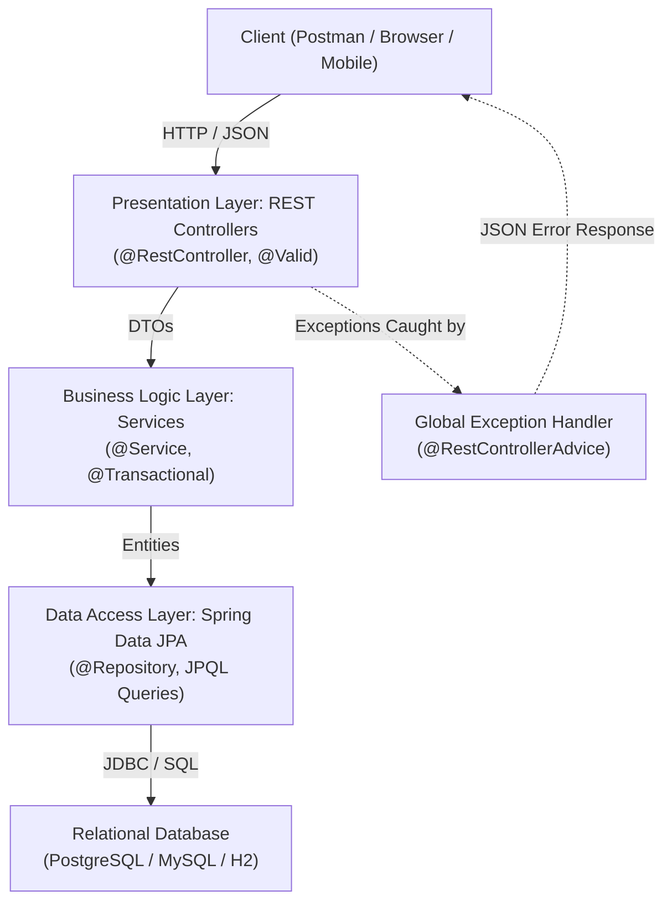
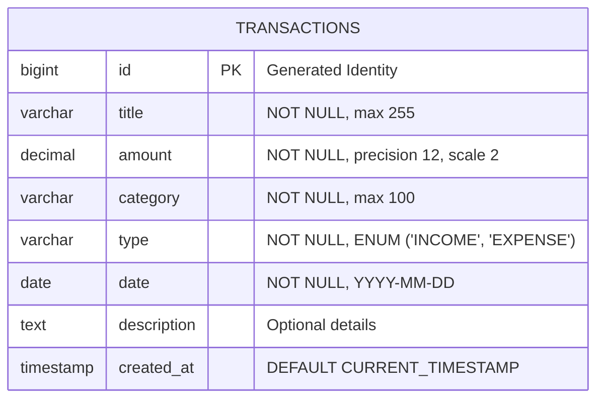

# Personal Expense Tracker — REST API & Core Java

A production-ready **Personal Expense Tracker backend** engineered in **Java 17** and **Spring Boot 3.3.4**, featuring clean layered architecture, relational persistence with **Spring Data JPA** (PostgreSQL/MySQL), robust **Jakarta Bean Validation**, and comprehensive automated test coverage with **JUnit 5 and Mockito**.

---

## Table of Contents
- [Problem & Motivation](#problem--motivation)
- [Key Features](#key-features)
- [Architecture & Design](#architecture--design)
- [Database Schema & ER Diagram](#database-schema--er-diagram)
- [Technology Stack](#technology-stack)
- [API Reference](#api-reference)
- [Prerequisites & Local Setup](#prerequisites--local-setup)
- [Automated Testing](#automated-testing)
- [Production Deployment Guide](#production-deployment-guide)
- [Future Roadmap](#future-roadmap)

---

## Problem & Motivation
Managing personal finances requires precision, zero rounding error, and reliable data modeling. Many expense trackers suffer from floating-point roundoff issues (using `double`), lack input boundaries, or expose raw database entities directly to the web.

This project addresses these challenges by:
1. Modeling monetary amounts with arbitrary-precision **`BigDecimal`** (enforcing 2 decimal places with `HALF_UP` rounding).
2. Implementing a strict **DTO boundary pattern** with Jakarta Bean Validation to eliminate over-posting risks and malformed inputs.
3. Offering dynamic multi-criteria filtering and pagination to handle growing datasets efficiently.
4. Supporting both local zero-configuration development (in-memory H2) and enterprise cloud deployments (PostgreSQL / MySQL).

---

## Key Features
- **Transaction CRUD:** Create, read, update, and delete income and expense records with unique auto-generated IDs.
- **Dynamic Pagination & Filtering:** Filter transactions by `type` (`INCOME`/`EXPENSE`), case-insensitive `category` substring, and date ranges (`startDate`, `endDate`) with pageable metadata.
- **Financial Analytics & Reporting:**
  - Aggregated income, total expenses, and net balance calculations.
  - Category-wise expense breakdown with calculated spend share percentages.
  - Highest single expense detection and average transaction metrics.
- **Input Validation & Crash-Proof Error Handling:** Global exception handling returning standardized RFC 7807-style JSON error payloads (`ErrorResponseDto`).
- **Cloud-Ready Health Checks:** Integrated Spring Boot Actuator (`/actuator/health`).
- **Configurable CORS:** Pre-configured for seamless integration with frontend frameworks (React, Vite, Vue).

---

## Architecture & Design

The application follows a **Hexagonal / Clean Layered Architecture**:



### Layer Responsibilities
- **Presentation (`controller`):** Handles HTTP status codes, routing, pagination arguments, and request validation. Zero direct SQL or business logic.
- **Data Transfer Objects (`dto`):** Immutable Java 17 records and validated request objects decoupling the external API contract from internal database schemas.
- **Business Logic (`service`):** Transactional business workflows, math calculations, and Entity <-> DTO conversions.
- **Data Access (`repository`):** Spring Data JPA dynamic query methods and JPQL projections.
- **Domain (`entity`):** Relational entity mapping with column constraints and primary keys.

---

## Database Schema & ER Diagram



---

## Technology Stack
- **Language:** Java 17 LTS (Java 25 LTS compatible)
- **Framework:** Spring Boot 3.3.4
- **Web:** Spring Web (Spring MVC, Jackson JSON)
- **Persistence & ORM:** Spring Data JPA, Hibernate 6
- **Database:** PostgreSQL (production), MySQL (supported), H2 (in-memory dev/test)
- **Validation:** Jakarta Bean Validation (Hibernate Validator)
- **Monitoring:** Spring Boot Actuator
- **Testing:** JUnit 5, Mockito, Spring Boot MockMvc, AssertJ
- **Build & Dependency Tool:** Apache Maven
- **Containerization:** Multi-stage Docker

---

## API Reference

### Base URL: `http://localhost:8080/api`

| Method | Endpoint | Description | Status Code |
| :--- | :--- | :--- | :--- |
| `POST` | `/transactions` | Create a transaction | `201 Created` |
| `GET` | `/transactions` | List transactions (supports pagination & filters) | `200 OK` |
| `GET` | `/transactions/{id}` | Retrieve transaction by ID | `200 OK` |
| `PUT` | `/transactions/{id}` | Update transaction by ID | `200 OK` |
| `DELETE` | `/transactions/{id}` | Delete transaction by ID | `204 No Content` |
| `GET` | `/reports/summary` | Net balance, income, expense summary | `200 OK` |
| `GET` | `/reports/categories` | Category-wise expense breakdown & share | `200 OK` |
| `GET` | `/actuator/health` | Service health status | `200 OK` |

---

### Sample Requests & Responses

#### 1. Create Transaction (`POST /api/transactions`)
**Request Payload:**
```json
{
  "title": "Software Engineering Salary",
  "amount": 6500.00,
  "category": "Salary",
  "type": "INCOME",
  "date": "2026-10-01",
  "description": "Monthly direct deposit"
}
```
**Response (`201 Created`):**
```json
{
  "id": 1,
  "title": "Software Engineering Salary",
  "amount": 6500.00,
  "category": "Salary",
  "type": "INCOME",
  "date": "2026-10-01",
  "description": "Monthly direct deposit"
}
```

#### 2. Validation Error Handling (`POST /api/transactions` with invalid data)
**Request Payload:**
```json
{
  "title": "",
  "amount": -50.00,
  "category": "",
  "type": "EXPENSE",
  "date": "2026-10-01"
}
```
**Response (`400 Bad Request`):**
```json
{
  "timestamp": "2026-10-13T20:15:00",
  "status": 400,
  "error": "Bad Request",
  "message": "Validation failed for one or more fields",
  "path": "/api/transactions",
  "validationErrors": {
    "amount": "Amount must be strictly greater than zero",
    "title": "Title is required and cannot be blank",
    "category": "Category is required and cannot be blank"
  }
}
```

#### 3. Paginated & Filtered Query (`GET /api/transactions?type=EXPENSE&page=0&size=10&sort=date,desc`)
**Response (`200 OK`):**
```json
{
  "content": [
    {
      "id": 2,
      "title": "Groceries",
      "amount": 185.50,
      "category": "Food",
      "type": "EXPENSE",
      "date": "2026-10-05",
      "description": "Supermarket"
    }
  ],
  "page": {
    "size": 10,
    "number": 0,
    "totalElements": 1,
    "totalPages": 1
  }
}
```

#### 4. Financial Summary (`GET /api/reports/summary`)
**Response (`200 OK`):**
```json
{
  "totalIncome": 6500.00,
  "totalExpenses": 185.50,
  "netBalance": 6314.50,
  "transactionCount": 2,
  "highestExpense": 185.50,
  "averageExpense": 185.50
}
```

---

## Prerequisites & Local Setup

### Prerequisites
- **Java:** JDK 17 or higher (`java -version`)
- **Maven:** Version 3.8+ (`mvn -version`)
- **Database:** PostgreSQL or MySQL (optional; defaults to in-memory H2 if no DB is specified)

### Option 1: Quick Start with In-Memory H2 (Zero Configuration)
Clone the repository and run:
```bash
mvn spring-boot:run
```
The application will start on `http://localhost:8080`.

### Option 2: Running with PostgreSQL
1. Create database:
   ```sql
   CREATE DATABASE expense_tracker_db;
   ```
2. Configure environment variables in terminal:
   ```bash
   # Windows PowerShell
   $env:DB_URL="jdbc:postgresql://localhost:5432/expense_tracker_db"
   $env:DB_USER="postgres"
   $env:DB_PASSWORD="your_password"
   $env:DB_DRIVER="org.postgresql.Driver"

   # Linux/macOS
   export DB_URL="jdbc:postgresql://localhost:5432/expense_tracker_db"
   export DB_USER="postgres"
   export DB_PASSWORD="your_password"
   export DB_DRIVER="org.postgresql.Driver"
   ```
3. Start the application:
   ```bash
   mvn spring-boot:run
   ```

### Option 3: Running with Docker
```bash
# Build the production image
docker build -t expense-tracker-api .

# Run the container
docker run -p 8080:8080 expense-tracker-api
```

---

## Automated Testing

The project maintains an automated test pyramid across service, repository, and controller layers:

```bash
mvn test
```

### Test Suite Summary:
- **`ExpenseManagerTest` (14 tests):** Core Java unit and integration tests covering in-memory transaction management, BigDecimal calculations, Lambda filtering and sorting, CSV file parsing resilience, and Plain JDBC CRUD with transaction rollback.
- **`TransactionServiceTest` (11 tests):** Unit tests using JUnit 5 and Mockito verifying business logic, DTO mapping, date boundary validation, and exact financial math.
- **`TransactionJpaRepositoryTest` (6 tests):** Integration tests using `@DataJpaTest` testing dynamic JPQL filters, pagination, boundary queries, and group-by projections.
- **`TransactionControllerTest` (8 tests):** Web layer MockMvc integration tests testing status codes (`201`, `200`, `204`, `400`, `404`), pagination, validation error envelopes, and type coercion.
- **`ReportControllerTest` (3 tests):** Slice tests using `@WebMvcTest` verifying financial summaries and category breakdown projections.

**Official Test Results:**
```text
[INFO] Results:
[INFO] 
[INFO] Tests run: 42, Failures: 0, Errors: 0, Skipped: 0
[INFO] 
[INFO] ------------------------------------------------------------------------
[INFO] BUILD SUCCESS
[INFO] ------------------------------------------------------------------------
```

---

## Production Deployment Guide

### Deployment Architecture
```
  [User Traffic] ──HTTPS──> [Reverse Proxy / Cloud Ingress]
                                      │
                                      ▼
                        [Spring Boot Container] (Port 8080)
                                      │
                                      ▼
                     [Managed PostgreSQL (AWS RDS / Supabase)]
```

### Production Checklist:
1. **Container Hosting:** Deploy via container on platforms such as **Render**, **Railway**, **AWS ECS**, or **Google Cloud Run** using the provided multi-stage [Dockerfile](file:///d:/Project/New%20folder%20%282%29/Dockerfile).
2. **Environment Variables:** Provide production credentials exclusively via environment variables:
   - `DB_URL`: `jdbc:postgresql://<host>:<port>/<dbname>?sslmode=require`
   - `DB_USER`: database user
   - `DB_PASSWORD`: database password
3. **Health Check Monitoring:** Point load balancer probes to `/actuator/health`.
4. **HTTPS & Security:** Enforce SSL at the cloud ingress/load balancer level. Credentials and `db.properties` are strictly excluded from version control via `.gitignore`.

---

## Future Roadmap
- [ ] **Authentication & Security:** Add Spring Security with JWT authentication for multi-tenant user account isolation.
- [ ] **Schema Versioning:** Integrate Flyway migration scripts (`flyway-core`) for database migrations.
- [ ] **OpenAPI / Swagger UI:** Add `springdoc-openapi` for browser-based interactive documentation.
- [ ] **Data Export:** Add CSV/Excel export endpoints for periodic records download.
- [ ] **Frontend Application:** Connect a responsive React/Vite web application.
